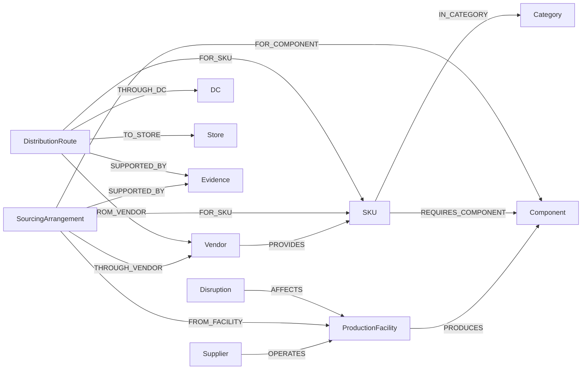

# Supply Chain Disruption Impact

## Chat interface

```powershell
python -m uv sync
python -m uv run streamlit run streamlit_app.py
```

Open **http://localhost:8501** to chat with the agent. The interface reads your existing local environment configuration, supports follow-ups, displays source evidence, and offers JSON downloads. Use the sidebar to start a new conversation, choose the data source/date, or check graph connectivity. Both data modes use OpenAI for answers; API quota/billing limits still apply. See [the UI notes](docs/agent.md#streamlit-chat).

A **uv-managed Python project** with a synthetic graph foundation and a LangChain/LangGraph conversational agent. The phase-one offline commands need no API credentials; the agent uses Neo4j and OpenAI. See [the agent guide](docs/agent.md).

The fixture contains **53 business nodes**, plus scoped sourcing, distribution, and evidence records. All businesses, approvals, notices, and source documents are fictional. This project identifies **potential dependency exposure**, not actual shortages, production capacity, delivery dates, or financial losses.

## Quick start

Run from this project directory:

```powershell
uv sync
uv run python -m supply_chain validate
uv run python -m supply_chain investigate D-01
uv run python -m supply_chain investigate "Summit North" --format json --output reports/summit.json
uv run python -m unittest discover -s tests -v
```

If uv is installed as a Python module but is not on PATH, replace `uv` with `python -m uv`. The agent dependencies are recorded in the uv lockfile; phase-one logic remains standard-library Python. The project uses uv's non-package application mode; commands run from the project root. Python 3.14 is selected by [.python-version](.python-version); the code supports Python 3.11 or newer.

The generated [scenario](data/scenario.json), [source records](data/evidence/), and [Neo4j import](neo4j_graph/import.cypher) are already included. Rebuild them only when deliberately resetting the synthetic fixture:

```powershell
uv run python -m supply_chain generate
uv run python -m supply_chain export
```

`generate` overwrites the scenario and fixture evidence files. `export` overwrites the generated Cypher import script. Neither command connects to or modifies a database.

## Ingest into Neo4j

### Recommended on Windows: uv Python importer

No Java or Cypher Shell installation is required. From this project directory run:

```powershell
python -m uv run scripts/import_graph.py
```

Enter your connection URI and database password at the prompts. The password is hidden and is not saved. The script declares the official Neo4j Python driver as a uv script dependency; uv installs it into an isolated script environment on first run. You can also supply `--uri`, `--username`, and `--database`, or use `NEO4J_URI`, `NEO4J_USERNAME`, `NEO4J_DATABASE`, and `NEO4J_PASSWORD` environment variables.

The importer executes [import.cypher](neo4j_graph/import.cypher), creates the schema separately, commits data in batches of 100 statements, and prints progress and final counts. If interrupted, committed batches remain; rerun the same generated script to resume safely using its MERGE statements. Use a dedicated demo database. This runner supports the exporter's one-statement-per-line format, not arbitrary multiline Cypher files.

Local file validation without credentials or a database connection:

```powershell
python scripts/import_graph.py --check-file
```

The importer has been exercised against Aura by the user; automated tests remain local and do not require database credentials. The offline phase-one analyzer still requires no third-party packages.

### Other import methods


Use a dedicated demo database: fixture IDs are intentionally stable and not namespaced for sharing with operational data.

1. Open [neo4j_graph/import.cypher](neo4j_graph/import.cypher).
2. Execute it with `cypher-shell` or your Neo4j query application's script execution facility. If your application only supports one statement at a time, use `cypher-shell` for the complete file.
3. Run the count query at the end of [neo4j_graph/queries.cypher](neo4j_graph/queries.cypher).
4. Run individual investigation queries from that file with the appropriate target and date parameters.

Example shell import (replace the connection URI and database name; the password is prompted rather than stored in the project):

```powershell
cypher-shell -a "neo4j+s://YOUR-HOST" -u neo4j -d neo4j -f neo4j_graph/import.cypher
```

For a local instance, use its local URI, such as `neo4j://localhost:7687`.

The script targets Neo4j 5+ Cypher syntax, creates a unique `Entity.id` constraint, and uses `MERGE` for nodes and relationships. Replaying the unchanged fixture does not create duplicates. It does **not** delete obsolete records if you later change or remove fixture relationships: use a fresh demo database for a revised fixture or implement an explicit reconciliation process.

`queries.cypher` contains Neo4j Browser `:param` commands. Those are client commands, not statements to send through a driver. Execute queries individually; for driver use, supply parameter dictionaries and omit the `:param` lines. Use entity IDs such as `FAC-AE` as `$target`, not disruption IDs. To investigate `D-01`, first resolve its `AFFECTS` target and check its validity window.

The user has verified the import and key sourcing, exposure, and backup queries against Aura. The offline test suite does not execute Cypher or constitute full live-query parity coverage.

## Included scenarios

The four notices are **independent hypothetical scenarios**, valid from October 1, 2026, until November 1, 2026 (end exclusive). Default investigation date: October 14, 2026.

| ID | Scenario | Expected behavior |
|---|---|---|
| D-01 | Apex East shutdown | Exposes cotton and technical-fabric dependencies from that facility; excludes Everyday's Apex West cotton sourcing |
| D-02 | Apex Textiles outage | Includes East and West; rejects West as an unaffected alternative to East |
| D-03 | East DC closure | Finds only active East routes to Boston and NYC; checks SKU/vendor/store-specific backups |
| D-04 | Component-wide Metal Zipper hold | Cross-category exposure; Travel Bag's missing source is explicitly unverified |

Additional direct-target investigation:

```powershell
uv run python -m supply_chain investigate FAC-SN
uv run python -m supply_chain investigate FAC-AE --date 2025-06-01
uv run python -m supply_chain investigate D-03 --format json --output reports/east-dc.json
```

Summit North has a documented Flex alternative for UrbanCarry; TrailWorks' alternative is pending approval and cannot be presented as approved. The historical query finds an expired Everyday sourcing arrangement but reports unknown downstream coverage because route history is absent.

## Graph model



Sourcing arrangements preserve component + facility + vendor + SKU scope. Distribution routes preserve vendor + SKU + DC + store scope. An active route does not imply every SKU from that vendor visits that store. The general `SERVES`, `BACKUP_COVERAGE`, `CARRIES`, and `PROVIDES` edges support exploration, not temporal impact decisions.

See [the data dictionary](docs/data-dictionary.md) for semantics and [the evaluation matrix](evaluations/scenarios.md) for expected outcomes.

## Report behavior

- Approved active records valid on the requested date establish exposure.
- An affected vendor–SKU pair joins only to routes with the same pair.
- Approved, valid, documented backup records are checked separately.
- A backup within the disrupted supplier is excluded for a supplier outage.
- The same component from another facility is not a fallback for a component-wide hold.
- Missing evidence produces an `unverified_dependency` finding, excluded from the supported exposure summary.
- No distribution match means unknown downstream coverage, not proof of no exposed stores.
- Alternative approval does not prove capacity, availability, or mitigation of every component dependency.
- Entity ambiguity returns candidates; the CLI never silently chooses a fuzzy match.

The JSON report includes exact `dependency_edges` (a small branching subgraph) with source IDs. The `path` field is an ordered explanation, **not** a claim that all consecutive items have a direct Neo4j edge. The sourcing and route nodes link the branches. Sources are included in the report and in [data/evidence](data/evidence/).

## Validation and tests

```powershell
uv run python -m supply_chain validate
uv run python -m unittest discover -s tests -v
```

Validation checks unique IDs, typed references, date intervals, approval values, required components, facility production capability, vendor approval, DC scope, and evidence references. One expected warning is deliberately retained: sourcing record `SA-067` (Travel Bag / Metal Zipper) lacks source evidence.

The tests cover explicit expected SKU/store outcomes, vendor isolation, historical sourcing, same-supplier alternatives, pending approval, DC backup routes, missing evidence, ambiguity, graph integrity, and repeatable exports. No live Neo4j connection is required. Expected outcomes are specified independently in assertions and the evaluation matrix.

## Boundaries and next phase

This phase includes the fixture, offline analyzer, Python database importer, Cypher import and investigation queries, source records, tests, and [Aura community-detection queries](neo4j_graph/communities.cypher). The conversational CLI, LangGraph runtime, Neo4j snapshot adapter, OpenAI integration, and optional LangSmith tracing are now implemented in the separate agent package. A Streamlit chat UI is included; LLM-based document extraction is not included.

An investigation date selects relationship validity, not what an analyst knew at that historical moment. Historical knowledge reconstruction would additionally filter source recording times. Alternate materials, batches, multiple simultaneous disruptions, supplier switching, and complete multi-component mitigation plans require additional modeling.

## Community detection

Run the numbered sections of [communities.cypher](neo4j_graph/communities.cypher) individually in Aura Query. They preview documented active vendor-SKU sourcing, project shared facilities with packaging excluded, stream Leiden communities, and drop the temporary projection. The user has verified this workflow in Aura. Projection creates an analytics session subject to the account plan; clean it up after use. Community membership describes shared dependencies, not confirmed disruption impact.

## Repository layout: graph foundation versus agent

Graph creation and import are separate from the conversational agent in [supply_chain/agent](supply_chain/agent/).

| Location | Responsibility |
|---|---|
| [graph_fixture.py](supply_chain/graph_fixture.py) | Create synthetic graph entities, sourcing records, routes, and evidence |
| [graph_export.py](supply_chain/graph_export.py) | Convert the fixture into the Neo4j Cypher import |
| [impact_analysis.py](supply_chain/impact_analysis.py) | Deterministic offline validation and impact analysis; no LLM |
| [import_graph.py](scripts/import_graph.py) | Load the generated graph into Neo4j |
| [neo4j_graph/](neo4j_graph/) | Graph import, impact queries, and community-detection Cypher |
| [data/](data/) | Canonical synthetic scenario and evidence |
| [test_graph_foundation.py](tests/test_graph_foundation.py) | Graph data, traversal, and export tests |
| [test_graph_import.py](tests/test_graph_import.py) | Import-script tests |

Phase-two orchestration lives in [supply_chain/agent](supply_chain/agent/) and reuses the graph foundation through typed retrieval tools. See [the agent guide](docs/agent.md) for configuration, tools, conversation persistence, and limitations. The existing `python -m supply_chain` commands are unchanged; the database import command is now `python -m uv run scripts/import_graph.py`.

Local inference is available through Ollama without an OpenAI API key. See [Ollama setup](docs/agent.md#local-ollama-models).
