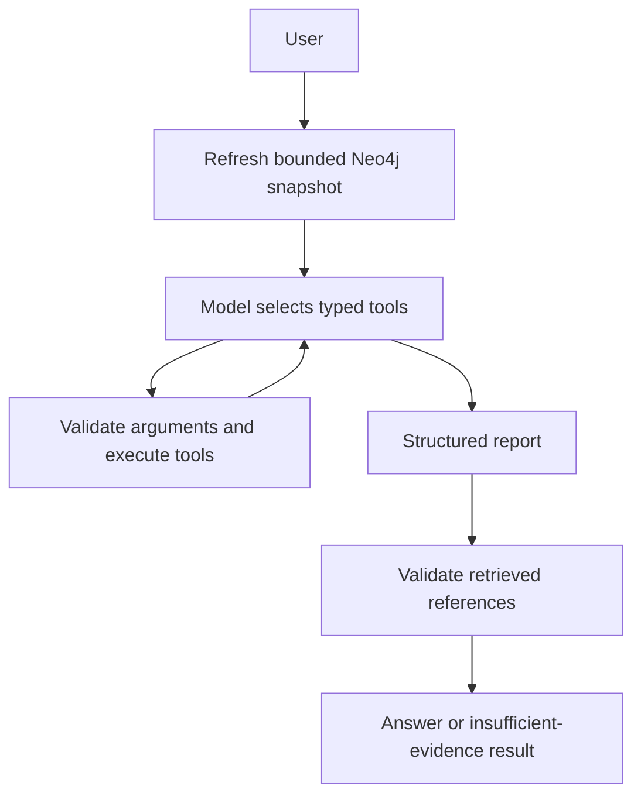

# Supply chain agent

## Streamlit chat

```powershell
python -m uv run streamlit run streamlit_app.py
```

Open http://localhost:8501. Chat supports follow-up questions, suggested starting questions, investigation progress, source excerpts, and downloaded findings. The sidebar offers a new conversation, date selection, live Neo4j or local sample data, and a graph connection check that does not call the model.

Changing date or data source clears the current UI conversation to avoid mixing scopes. Questions may still specify their own date. UI conversations are isolated in browser-session state, not shared with the CLI's SQLite conversations; reloading/disconnecting the browser may reset them. Failed requests leave successful model history intact. No global cache holds users' chat history or database clients. Database clients are closed after each request. Community analysis follows the existing environment toggle.

The app binds to localhost and reads credentials on the server from `.env`; it does not display them or ask users to paste them into chat. This is a local development UI without authentication. Add access controls before deploying it for other users. Local-sample mode still calls the configured model provider; API rate or quota failures are displayed as actionable errors rather than raw SDK tracebacks.

UI tests use Streamlit AppTest with a mocked agent so they do not consume API credits. They check rendering, chat submission, follow-up history, resetting, missing configuration, and error handling.

The agent is implemented in [supply_chain/agent](../supply_chain/agent/). Graph creation, export, and import remain separate.

## Run

```powershell
python -m uv sync
python -m uv run python -m supply_chain.agent --check
python -m uv run python -m supply_chain.agent --evaluate-graph
python -m uv run python -m supply_chain.agent
```

The agent reads the project-root `.env` automatically. Required values: `NEO4J_URI`, `NEO4J_USERNAME`, `NEO4J_PASSWORD`, `NEO4J_DATABASE`, `LLM_PROVIDER=openai`, `LLM_MODEL=gpt-5-mini`, and `LLM_API_KEY`. See [.env.example](../.env.example). The model base URL is optional. Model calls and retrieved business evidence go to the configured OpenAI endpoint. LangSmith tracing is off unless explicitly enabled in configuration.

The default date is **2026-10-14**, matching the synthetic fixture, not the current calendar date. Specify another date in your question to change it.

Examples:

```powershell
python -m uv run python -m supply_chain.agent --question "Apex East shut down. Which SKUs and stores are potentially exposed?"
python -m uv run python -m supply_chain.agent --question "Which approved alternative exists for SA-001 if Apex East shuts down?" --output reports/answer.json
python -m uv run python -m supply_chain.agent --thread my-investigation
```

Interactive follow-ups: “Only show footwear”, “Why is Boston affected?”, “What if the entire supplier is unavailable?”, “Show the source for that approval”. Type `/exit` to finish. The printed conversation ID can be supplied with `--thread` to resume it. Checkpoints are stored locally under `.agent_state/`, excluded from version control; they contain conversation and evidence data but not the configuration object.

`--fixture` uses local synthetic graph data instead of Neo4j. It **still calls the configured model provider** for conversation. `--check` performs configuration and graph-access checks without an LLM call. `--fixture --check` performs a fully local graph check. `--json` renders the structured answer. `--output` saves the answer, tool arguments/results, and reference-validation errors without credentials.

## Architecture



LangChain binds typed tools to ChatOpenAI or ChatOllama. An explicit LangGraph StateGraph controls the tool loop, budgets, report generation, and reference validation. SQLite checkpoints preserve conversational context across process restarts. Each new question resets its tool budget and evidence ledger; follow-up context persists, but new answers must use evidence retrieved in that turn.

### Prototype retrieval choice

For this small graph, the Neo4j adapter reads nodes and scoped edges in a single managed read transaction at the start of each turn, reconstructs the business records, and reuses [impact_analysis.py](../supply_chain/impact_analysis.py). It does not pass the entire graph to the LLM. This avoids implementing different impact rules in Python and Cypher. Snapshot size is capped at 5,000 Entity nodes and 20,000 relationships; larger graphs fail explicitly and require a scoped-query adapter. Neo4j's isolation guarantees still apply: avoid concurrent graph updates during a demo investigation.

Ownership and production capability are static in the fixture. Historical queries filter sourcing/routing validity, not historical knowledge availability. The adapter is designed for this schema and a dedicated demo database, not arbitrary Neo4j graphs.

## Tools

| Tool | Purpose |
|---|---|
| resolve_entity_tool | Resolve names and IDs; return ambiguity candidates |
| get_disruption_details | Retrieve notice scope, dates, evidence, and applicability |
| trace_sourcing_exposure | Trace supplier/facility/component dependencies through vendor-SKU routes |
| trace_distribution_exposure | Inspect active routes for one vendor-SKU pair |
| trace_dc_exposure | Trace active routes through a disrupted DC |
| find_sourcing_alternatives | Find scoped, approved, unaffected backup sourcing |
| find_route_alternatives | Find backups for routes affected by the specified DC |
| get_dependency_evidence | Retrieve exact source excerpts and records |
| analyze_supply_communities | Run opt-in Aura community detection with cleanup |

Alternative tools first verify that their input records are active dependencies of the specified disruption. This prevents stale target parameters from producing inappropriate recommendations. Exposure summaries are complete for the loaded graph; details above 100 findings are explicitly marked truncated. Evidence retrieval and alternatives have per-call limits. Results distinguish unsupported scope, ambiguity, no matches, missing evidence, disabled analytics, and failures.

## Community detection

Set `COMMUNITY_ANALYTICS_ENABLED=true` only when you want the agent to create Aura analytics sessions. This can incur charges under your Aura plan. Ask “Which vendor-SKU groups share production facilities?” The backend uses the validated [community queries](../neo4j_graph/communities.cypher), a unique graph name per request, and a cleanup attempt in `finally`. An inactivity TTL is also configured. Cleanup failures are reported. No community properties are written to the business graph.

Community analysis reads the live graph separately from the turn snapshot. It excludes packaging, backups, and undocumented sourcing. Groups are structural observations, not proof of impact, complete sourcing coverage, or risk scores.

## Validation and limits

```powershell
python -m uv run python -m unittest discover -s tests -v
```

Offline tests exercise the real LangGraph workflow using a scripted model, actual typed tools, graph snapshot round-tripping, scope checks, missing evidence, budgets, checkpointed follow-ups, and safe error reporting. They need neither API credentials nor network access. The previous phase-one tests remain in place.

`--evaluate-graph` checks ten explicit scenario expectations against the configured live graph without an LLM call. Add `--fixture` for the same checks locally. This verifies graph results, not natural-language answer quality. Initial implementation verification successfully connected to the live graph; live GPT answer verification was blocked by an OpenAI rate-limit/quota response, so no successful live model answer is claimed.

The report validator verifies that cited entity/evidence references were retrieved this turn. It does **not** prove that every generated sentence is semantically entailed by its citations. Inspect traces and scenario results for answer-quality evaluation. The agent cannot establish stockouts, capacity, sales losses, simultaneous-disruption effects, or batch-level recall scope from this dataset.

LangSmith is optional: set `LANGSMITH_TRACING=true`, `LANGSMITH_API_KEY`, `LANGSMITH_PROJECT`, and the correct regional endpoint. Traces can include user questions, tool arguments, source records, and model outputs. Credentials are never deliberately added to state, tool responses, or saved reports.

Tool failures return sanitized error types. CLI configuration/connection/model errors report only the exception class to avoid leaking credentials. If connection checks fail, confirm instance status, URI, database password, network access, and graph integrity. If model calls fail, confirm API access and billing. No live database mutations occur during normal impact investigations.

## Implementation verification

- 36 automated local tests passed.
- Live Neo4j access succeeded: 49 entity records, 70 sourcing arrangements, 86 routes, and 160 evidence records.
- All ten live graph regression checks passed.
- OpenAI smoke checks returned `OpenAIRateLimitError` before generating an answer; end-to-end live LLM verification remains pending.
- The agent-managed Aura analytics lifecycle was not run during implementation; the underlying manual Cypher workflow was previously verified by the user.

## Local Ollama models

Install [Ollama for Windows](https://ollama.com/download/windows), start Ollama, then download a tool-capable model:

```powershell
ollama pull qwen3:8b
```

Configure the project-root `.env`:

```dotenv
LLM_PROVIDER=ollama
LLM_MODEL=qwen3:8b
OLLAMA_BASE_URL=http://localhost:11434
OLLAMA_NUM_CTX=32768
OLLAMA_TIMEOUT_SECONDS=300
```

An OpenAI API key is not required for this provider. Existing OpenAI credentials can remain for switching back. Ollama uses its own base URL, so an existing `LLM_BASE_URL` cannot accidentally route local requests to OpenAI. Neo4j settings remain necessary when using the live graph.

Qwen3 8B is a starting model, not a validated accuracy guarantee. Available RAM/VRAM determines usable model and context sizes; CPU inference can be slow. The context setting reserves space for tool schemas, graph results, and conversation. Smaller contexts risk truncating evidence; start a new conversation or narrow questions if context becomes too large. Tool-call budgets and reference validation still apply. LangSmith tracing, if enabled, still sends traces to LangSmith.

```powershell
ollama list
python -m uv run python -m supply_chain.agent.diagnostics
python -m uv run streamlit run streamlit_app.py
```

If the server is unreachable, open the Ollama app or run `ollama serve`. A missing-model error requires `ollama pull` with the exact configured model tag. Ollama must support both tools and JSON-schema structured output. The agent uses native JSON-schema output for its final report, separately from tool selection. No live model quality evaluation has been completed merely by enabling this provider.

## Ollama Cloud with an API key

No local Ollama installation or model download is needed. Create a key at https://ollama.com/settings/keys and configure `.env`:

```dotenv
LLM_PROVIDER=ollama_cloud
LLM_MODEL=gpt-oss:120b
OLLAMA_API_KEY=your-ollama-key
```

This provider calls `https://ollama.com` directly with an Authorization bearer header. It never reuses the OpenAI key or the local Ollama base URL. Choose direct API model names from https://ollama.com/api/tags (without a CLI `-cloud` suffix). Questions and retrieved evidence are processed in Ollama Cloud, subject to your Ollama account's usage limits.

Cloud does not currently support enforced JSON-schema output, so finalization uses a report tool with Pydantic parsing followed by the existing evidence-reference validation. Missing or malformed reports fail the turn instead of displaying unvalidated prose. Tool selection and report quality require a live smoke test with your key; offline tests do not verify cloud accuracy. See https://docs.ollama.com/cloud and https://docs.ollama.com/capabilities/structured-outputs.
