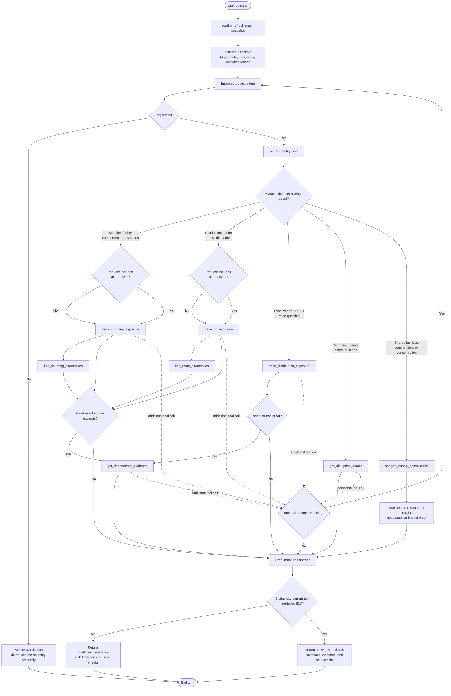
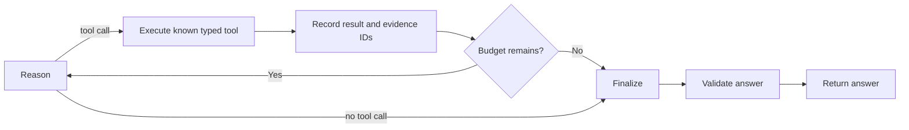

# LangGraph Request Paths

This diagram describes the request-specific paths supported by the supply-chain agent. The existing runtime remains bounded and evidence-backed: the model selects only registered typed tools, tool results are recorded in the current turn, and the final answer is validated before it is returned.

## Request routing graph

## Path summary

| User request pattern | Primary path | Optional follow-up |
|---|---|---|
| “What is affected by supplier/facility X?” | `resolve_entity_tool` → `trace_sourcing_exposure` | `get_dependency_evidence` |
| “Which backup suppliers can we use?” | `trace_sourcing_exposure` → `find_sourcing_alternatives` | `get_dependency_evidence` |
| “Which stores are affected by DC X?” | `resolve_entity_tool` → `trace_dc_exposure` | `find_route_alternatives` |
| “What routes exist for vendor V and SKU S?” | `resolve_entity_tool` → `trace_distribution_exposure` | `get_dependency_evidence` |
| “What does disruption D cover?” | `resolve_entity_tool` → `get_disruption_details` | `get_dependency_evidence` |
| “Which vendors share production facilities?” | `analyze_supply_communities` | None; result is structural only |
| Ambiguous name or target | `resolve_entity_tool` | Ask the user to select a candidate |
| Unsupported or unverified claim | Final validation | Return `insufficient_evidence` |

## Runtime control loop

The request-specific paths above run inside the existing bounded loop:

The implementation of this loop is in [`workflow.py`](../supply_chain/agent/workflow.py), and the registered tools are in [`tools.py`](../supply_chain/agent/tools.py).
